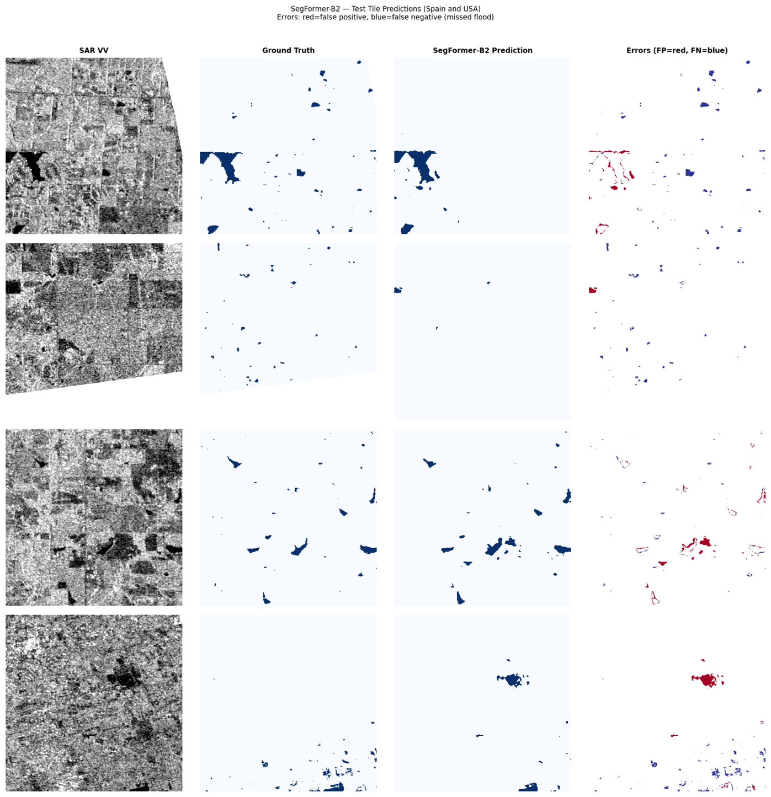
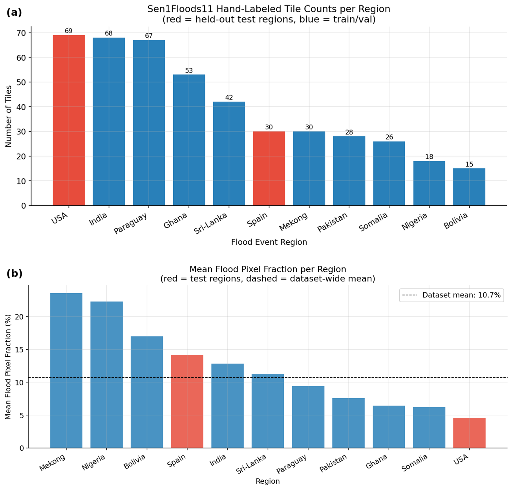
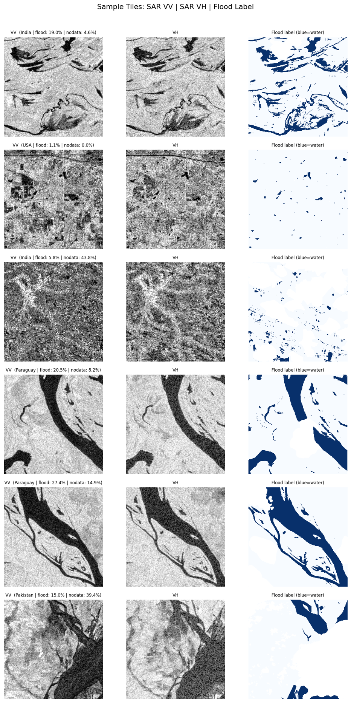
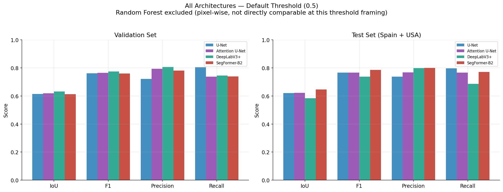
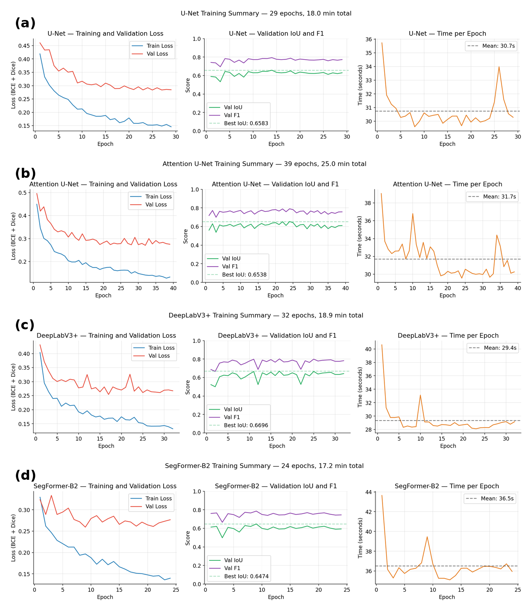
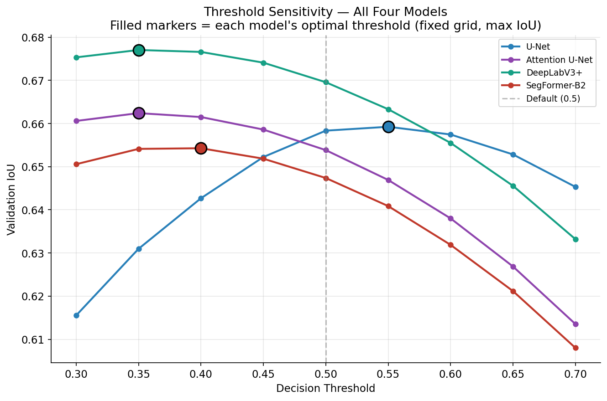
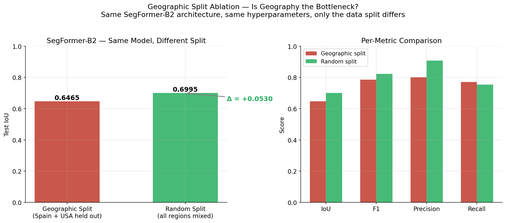
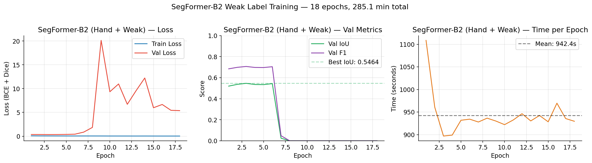

# Floodwater Segmentation from Sentinel-1 SAR Imagery

**Benchmarking CNN and Transformer architectures for cross-geographic flood mapping on Sen1Floods11**

MSc Artificial Intelligence and Data Science dissertation, University of Hull (August 2026)
**Author:** Sherifdeen Ajibola Oloye


<p align="center">
  
  <br><em>SegFormer-B2 on held-out test tiles: SAR input, ground truth, prediction, and errors (red = false positive, blue = missed flood).</em>
</p>

---

## Overview

Floods are among the most destructive natural hazards worldwide. They affected about two billion people between 1998 and 2017 and caused an estimated USD 656 billion in losses. Fast, accurate flood maps are critical for emergency response. Optical satellites are often blinded by the cloud cover that comes with major flood events. **Synthetic Aperture Radar (SAR)** sees through cloud and darkness, and calm open water appears distinctly dark in the backscatter signal.

Automated SAR flood segmentation models often **fail to generalise beyond the regions they were trained on**. This project trains five segmentation models under identical conditions and tests them on **flood events from countries the models never saw during training**. It then uses controlled experiments to find out *why* performance drops.

### Key findings

- **SegFormer-B2 performs best** on geographically unseen regions (test IoU **0.6465**), slightly ahead of Attention U-Net (0.6210) and U-Net (0.6200).
- **Geographic distribution shift, not model capacity, is the main barrier.** Adding a few target-region tiles to training raised Spain IoU from **0.4705 → 0.7486**.
- **More data is not always better.** A 20.2× expansion with Otsu weak labels *reduced* test IoU to **0.5978**. The model learned the weak labels' false positives.
- **Spatial context is essential.** A pixel-wise Random Forest collapsed to 0.1924 IoU. It flagged water almost everywhere (precision 0.1951, recall 0.9341).

> **Practical takeaway:** when deploying to a new region, a small number of hand-labelled tiles from that region is worth more than thousands of automatically generated weak labels.

---

## Table of Contents

- [Research Objectives](#research-objectives)
- [Dataset](#dataset)
- [Methodology](#methodology)
- [Results](#results)
- [Repository Structure](#repository-structure)
- [Getting Started](#getting-started)
- [Limitations and Future Work](#limitations-and-future-work)
- [Citation](#citation)
- [License](#license)
- [References](#references)

---

## Research Objectives

1. Implement and train five segmentation models (**Random Forest, U-Net, Attention U-Net, DeepLabV3+, SegFormer-B2**) under identical experimental conditions on the Sen1Floods11 hand-labelled dataset.
2. Evaluate each model on **geographically held-out test regions (Spain and USA)** using IoU, F1, precision and recall.
3. Apply **threshold optimisation** to all deep learning models and measure its effect on test performance.
4. Add representative target-region tiles to training, to find out whether the generalisation gap comes from **distribution shift or model capacity**.
5. Test whether **weak labels from unsupervised Otsu thresholding** can add to hand-labelled data and improve generalisation.

---

## Dataset

This project uses **[Sen1Floods11 v1.1](https://github.com/cloudtostreet/Sen1Floods11)** (Bonafilia et al., 2020). It contains Sentinel-1 SAR tiles covering 11 flood events in 11 countries.

| Property | Value |
|---|---|
| Hand-labelled tiles | 446 (512 × 512 px, 10 m resolution) |
| Input bands | VV + VH dual-polarisation backscatter (2 channels) |
| Labels | `1` = water, `0` = non-water, `-1` = no data |
| Water pixel fraction | 10.60% (8.4 : 1 class imbalance) |
| Weakly-labelled tiles | 4,384 (Otsu-thresholded, used in the weak-label experiment only) |

<p align="center">
  
  <br><em>Tile counts (a) and mean flood pixel fraction (b) per region. USA and Spain are held out as test regions.</em>
</p>

### Event-level geographic split

To measure true generalisation, the data is split **by flood event**, so no region appears in more than one split.

| Split | Regions | Tiles |
|---|---|---|
| **Test (held-out)** | USA, Spain | 99 |
| Train / Validation | India, Paraguay, Ghana, Sri Lanka, Mekong, Pakistan, Somalia, Nigeria, Bolivia | 299 / 48 |

<details>
<summary><b>Per-region statistics</b></summary>

| Region | Tiles | Mean Flood % | Median Flood % | Mean No-data % | Split |
|---|---:|---:|---:|---:|---|
| USA | 69 | 4.58 | 1.45 | 2.44 | Test (held-out) |
| Spain | 30 | 14.14 | 3.40 | 1.74 | Test (held-out) |
| India | 68 | 12.83 | 5.90 | 15.97 | Train/Val |
| Paraguay | 67 | 9.43 | 2.10 | 5.04 | Train/Val |
| Ghana | 53 | 6.43 | 0.00 | 33.83 | Train/Val |
| Sri Lanka | 42 | 11.24 | 3.00 | 9.51 | Train/Val |
| Mekong | 30 | 23.59 | 7.61 | 9.32 | Train/Val |
| Pakistan | 28 | 7.58 | 1.25 | 26.75 | Train/Val |
| Somalia | 26 | 6.17 | 2.26 | 21.13 | Train/Val |
| Nigeria | 18 | 22.27 | 2.37 | 14.31 | Train/Val |
| Bolivia | 15 | 16.99 | 6.27 | 27.07 | Train/Val |

</details>

<p align="center">
  
  <br><em>Example tiles: VV backscatter, VH backscatter, and hand-labelled flood mask (blue = water).</em>
</p>

---

## Methodology

### Preprocessing pipeline

```
Raw Sentinel-1 tile (VV, VH, 512×512)
  │
  ├─► Lee speckle filter (7×7 window)        removes SAR salt-and-pepper noise, preserves edges
  ├─► Z-score normalisation                   statistics from training tiles only (no leakage)
  │       VV: mean −10.803, std 3.269  |  VH: mean −17.252, std 3.983
  ├─► Split into 4 × 256×256 patches         discard patches with >95% no-data
  │       → 913 training / 191 validation patches
  ├─► Augmentation (train only)              horizontal/vertical flips, 90° rotation
  └─► Weighted sampling                      oversample flood-rich patches
```

Class imbalance is handled in three ways: **weighted sampling**, a **combined BCE + Dice loss**, and **no-data masking**, which excludes `label = −1` pixels from every loss term. Test evaluation runs **sliding-window inference on full 512 × 512 tiles**, matching how the model would be deployed.

### Models

| Model | Encoder | Key mechanism |
|---|---|---|
| **Random Forest** | None (pixel-wise VV/VH features) | Traditional baseline, no spatial context |
| **U-Net** | ResNet-34 (ImageNet) | Skip connections at four scales |
| **Attention U-Net** | ResNet-34 (ImageNet) | U-Net + scSE attention in each decoder block |
| **DeepLabV3+** | ResNet-34 (ImageNet) | Atrous Spatial Pyramid Pooling for multi-scale context |
| **SegFormer-B2** | MiT-B2 transformer (ImageNet) | Hierarchical self-attention + lightweight MLP decoder |

The pretrained encoders were adapted to 2-channel SAR input. For SegFormer, this was done by averaging the RGB patch-embedding weights across channels. The Random Forest is trained on a stratified sample of 500 flood and 500 non-flood pixels per patch.

### Training configuration (identical for all deep learning models)

| Hyperparameter | Value |
|---|---|
| Optimiser | AdamW |
| Initial learning rate | 1.0 × 10⁻⁴ |
| LR schedule | Cosine annealing |
| Loss | BCE + Dice (equal weighting) |
| Batch size | 16 |
| Max epochs | 50 |
| Early stopping | Patience 15 (monitoring val IoU) |
| Train/val input | 256 × 256 patches |
| Test inference | Sliding window on full 512 × 512 tiles |
| Random seed | 42 (reset before each model's DataLoader) |

**Primary metric: IoU** = TP / (TP + FP + FN). It penalises false positives and false negatives equally, so it is more robust to class imbalance than precision or recall alone.

---

## Results

### 1. Model comparison (held-out Spain + USA, threshold 0.5)

| Model | Val IoU | **Test IoU** | Test F1 | Test Precision | Test Recall | Epochs (best) |
|---|---:|---:|---:|---:|---:|---|
| Random Forest | 0.6018 | 0.1924 | 0.3227 | 0.1951 | 0.9341 | n/a |
| U-Net | 0.6141 | 0.6200 | 0.7654 | 0.7373 | 0.7957 | 29 (14) |
| Attention U-Net | 0.6191 | 0.6210 | 0.7662 | 0.7667 | 0.7658 | 39 (24) |
| DeepLabV3+ | **0.6316** | 0.5841 | 0.7375 | 0.7973 | 0.6860 | 32 (17) |
| **SegFormer-B2** | 0.6116 | **0.6465** | **0.7853** | **0.7999** | 0.7712 | 24 (9) |

<p align="center">
  
</p>

DeepLabV3+ has the **highest validation IoU but the weakest deep learning test IoU**. This suggests its multi-scale ASPP module is more sensitive to domain shift.

<details>
<summary><b>Per-region breakdown</b></summary>

| Model | Spain IoU | Spain F1 | Spain Prec. | Spain Recall | USA IoU | USA F1 | USA Prec. | USA Recall |
|---|---:|---:|---:|---:|---:|---:|---:|---:|
| Random Forest | 0.2408 | 0.3224 | 0.2453 | 0.8883 | 0.1040 | 0.1638 | 0.1064 | 0.8482 |
| U-Net | 0.4467 | 0.5546 | 0.5480 | 0.6322 | 0.3225 | 0.4431 | 0.5287 | 0.4674 |
| Attention U-Net | 0.4416 | 0.5551 | 0.5831 | 0.5759 | 0.3085 | 0.4238 | 0.6120 | 0.3995 |
| DeepLabV3+ | 0.4003 | 0.4989 | 0.6449 | 0.4754 | 0.2042 | 0.2851 | 0.6386 | 0.2543 |
| **SegFormer-B2** | **0.4705** | **0.5784** | 0.6347 | 0.5743 | **0.3410** | **0.4611** | 0.6208 | 0.4338 |

</details>

<details>
<summary><b>Training curves</b></summary>
<p align="center">
  
  <br><em>All four deep learning models converged well before the 50-epoch limit.</em>
</p>
</details>

### 2. Threshold optimisation

A threshold grid search (0.30–0.70, step 0.05) was run on the validation set, and the best threshold was then applied to the test set.

| Model | Optimal threshold | Val ΔIoU | Default Test IoU | Tuned Test IoU | Test ΔIoU |
|---|---:|---:|---:|---:|---:|
| U-Net | 0.55 | +0.0009 | 0.6200 | 0.6237 | +0.0038 |
| Attention U-Net | 0.35 | +0.0086 | 0.6210 | 0.5990 | −0.0220 |
| DeepLabV3+ | 0.35 | +0.0075 | 0.5841 | 0.5925 | +0.0083 |
| SegFormer-B2 | 0.40 | +0.0069 | 0.6465 | 0.6409 | −0.0056 |

Tuning improved validation IoU for **every** model but **reduced** test IoU for two of them. **Decisions calibrated on the validation set do not transfer reliably across a geographic boundary.**

<p align="center">
  
</p>

### 3. Is geography the bottleneck?

SegFormer-B2 was retrained on a **random 80/10/10 split**, so Spain and USA tiles appeared in training. All hyperparameters stayed the same.

| Condition | Overall Test IoU | **Spain IoU** | **USA IoU** | Precision | Recall |
|---|---:|---:|---:|---:|---:|
| Geographic split | 0.6465 | 0.4705 | 0.3410 | 0.7999 | 0.7712 |
| Random split | 0.6995 | **0.7486** | **0.4484** | 0.9075 | 0.7532 |
| Δ | +0.0530 | **+0.2781** | +0.1074 | +0.1076 | −0.0180 |

<p align="center">
  
</p>

Spain IoU rose by **27.8 points**. The same architecture learns Spain's flood signatures easily once it sees representative examples, which shows the gap is caused by **training data coverage, not architectural capacity**. USA improved less (+10.7 points). This is likely because of harder SAR conditions there, such as vegetation-obscured inundation and urban double-bounce.

### 4. Do weak labels help?

SegFormer-B2 was retrained on hand-labelled patches plus **17,536 Otsu-thresholded weak-label patches** (a 20.2× expansion). The validation and test sets stayed hand-labelled only.

| Condition | Overall Test IoU | Spain IoU | USA IoU | Precision | Recall |
|---|---:|---:|---:|---:|---:|
| Hand-only | **0.6465** | **0.4705** | **0.3410** | **0.7999** | 0.7712 |
| Hand + Weak | 0.5978 | 0.3855 | 0.3292 | 0.7263 | 0.7716 |
| Δ | −0.0487 | −0.0850 | −0.0118 | −0.0736 | +0.0004 |

<p align="center">
  
</p>

**Precision fell while recall did not change.** This is the signature of learned false positives. Otsu thresholding assumes a clean bimodal histogram, so it mislabels shadows, rough terrain and urban areas as water, and the model learned to repeat those mistakes. Training also took **285 minutes instead of 17**, and the result was still worse. **Label quality matters more than label quantity.**

---

## Repository Structure

```
flood_segmentation/
├── flood_water_segmentation.ipynb   # Full end-to-end pipeline (12 sections)
├── assets/                          # Figures used in this README
├── requirements.txt                 # Python dependencies
├── LICENSE                          # MIT License
└── README.md
```

The notebook is organised into self-contained sections:

| § | Section | § | Section |
|---|---|---|---|
| 1 | Environment setup, constants, paths, utilities | 7 | Attention U-Net |
| 2 | Exploratory data analysis | 8 | DeepLabV3+ |
| 3 | Preprocessing (split, speckle filter, normalisation, patching) | 9 | SegFormer-B2 |
| 4 | Dataset class, DataLoaders, loss, inference utilities | 10 | Threshold optimisation |
| 5 | Random Forest baseline | 11 | Geographic split ablation |
| 6 | U-Net | 12 | Weak label experiment |

Each training section uses a **skip-if-done checkpoint pattern**. If a trained checkpoint already exists, training is skipped, so you can re-run the notebook without retraining every model.

---

## Getting Started

### 1. Clone and install

```bash
git clone https://github.com/datawitholoye/sar-flood-segmentation.git
cd sar-flood-segmentation
python -m venv .venv
source .venv/bin/activate        # Windows: .venv\Scripts\activate
pip install -r requirements.txt
```

> Install the PyTorch build that matches your CUDA version from [pytorch.org](https://pytorch.org/get-started/locally/). The experiments were run on an **NVIDIA RTX 3090 (24 GB)**. A CUDA GPU is strongly recommended.

### 2. Download Sen1Floods11

The dataset is hosted on Google Cloud Storage. See the [Sen1Floods11 repository](https://github.com/cloudtostreet/Sen1Floods11) for details.

```bash
gsutil -m rsync -r gs://sen1floods11 ./Sen1Floods11
```

Expected layout:

```
Sen1Floods11/v1.1/data/flood_events/
├── HandLabeled/
│   ├── S1Hand/            # 446 SAR GeoTIFFs (VV + VH)
│   └── LabelHand/         # 446 hand-labelled masks
└── WeaklyLabeled/
    ├── S1Weak/            # 4,384 SAR tiles      (Section 12 only)
    └── S1OtsuLabelWeak/   # 4,384 Otsu labels    (Section 12 only)
```

### 3. Configure and run

Open the notebook and set `BASE_DATA_DIR` in **Section 1.5** to your local `Sen1Floods11/v1.1` path:

```python
BASE_DATA_DIR = Path('/path/to/Sen1Floods11/v1.1')
```

Then run the sections in order. Section 1.11 runs an environment health check that confirms the GPU and all data folders are found before any processing starts.

---

## Limitations and Future Work

- **Two held-out regions only.** Spain and USA show different degrees of shift. More held-out events would make the conclusions stronger.
- **Single-date SAR.** Flooded vegetation and urban double-bounce stay ambiguous without temporal context.
- **Future directions:**
  - **domain adaptation** to close the geographic gap without target labels
  - **pseudo-label filtering**, to keep the volume benefit of weak labels without their noise
  - **multi-temporal SAR input** (pre- vs post-event change detection)

---

## Citation

If you use this work, please cite:

```bibtex
@mastersthesis{oloye2026floodseg,
  author = {Oloye, Sherifdeen Ajibola},
  title  = {Floodwater Segmentation from Sentinel-1 SAR Imagery: Benchmarking CNN and Transformer Architectures for Cross-Geographic Generalisation},
  school = {University of Hull},
  year   = {2026},
  month  = {August},
  type   = {MSc dissertation}
}
```

Please also cite the dataset:

```bibtex
@inproceedings{bonafilia2020sen1floods11,
  author    = {Bonafilia, Derrick and Tellman, Beth and Anderson, Tyler and Issenberg, Erica},
  title     = {Sen1Floods11: A Georeferenced Dataset to Train and Test Deep Learning Flood Algorithms for Sentinel-1},
  booktitle = {Proceedings of the IEEE/CVF Conference on Computer Vision and Pattern Recognition Workshops},
  pages     = {210--211},
  year      = {2020}
}
```

---

## References

<details>
<summary>Show references</summary>

- Bentivoglio, R., Isufi, E., Jonkman, S.N. and Taormina, R. (2022). Deep learning methods for flood mapping: a review of existing applications and future research directions. *Hydrology and Earth System Sciences*, 26(16), 4345–4378. https://doi.org/10.5194/hess-26-4345-2022
- Bonafilia, D., Tellman, B., Anderson, T. and Issenberg, E. (2020). Sen1Floods11: A georeferenced dataset to train and test deep learning flood algorithms for Sentinel-1. *CVPR Workshops*, 210–211. https://doi.org/10.1109/CVPRW50498.2020.00113
- Chen, L.C., Zhu, Y., Papandreou, G., Schroff, F. and Adam, H. (2018). Encoder-decoder with atrous separable convolution for semantic image segmentation. *ECCV*, 801–818. https://doi.org/10.1007/978-3-030-01234-2_49
- Chini, M., Pelich, R., Pulvirenti, L., Pierdicca, N., Hostache, R. and Matgen, P. (2019). Sentinel-1 InSAR coherence to detect floodwater in urban areas: Houston and Hurricane Harvey as a test case. *Remote Sensing*, 11(2), 107. https://doi.org/10.3390/rs11020107
- CRED and UNDRR (2018). *Economic Losses, Poverty & Disasters 1998–2017*. https://www.undrr.org/publication/economic-losses-poverty-disasters-1998-2017
- Dosovitskiy, A. et al. (2021). An image is worth 16×16 words: transformers for image recognition at scale. *ICLR*. https://openreview.net/forum?id=YicbFdNTTy
- Hirabayashi, Y. et al. (2013). Global flood risk under climate change. *Nature Climate Change*, 3(9), 816–821. https://doi.org/10.1038/nclimate1911
- Katiyar, V., Tamkuan, N. and Nagai, M. (2021). Near-real-time flood mapping using off-the-shelf models with SAR imagery and deep learning. *Remote Sensing*, 13(12), 2334. https://doi.org/10.3390/rs13122334
- Martinis, S., Kersten, J. and Twele, A. (2015). A fully automated TerraSAR-X based flood service. *ISPRS Journal of Photogrammetry and Remote Sensing*, 104, 203–212. https://doi.org/10.1016/j.isprsjprs.2014.07.014
- Mason, D.C., Davenport, I.J., Neal, J.C., Schumann, G.J.P. and Bates, P.D. (2012). Near real-time flood detection in urban and rural areas using high-resolution SAR images. *IEEE TGRS*, 50(8), 3041–3052. https://doi.org/10.1109/TGRS.2011.2178030
- Oktay, O. et al. (2018). Attention U-Net: learning where to look for the pancreas. *MIDL Workshop*. arXiv:1804.03999
- Otsu, N. (1979). A threshold selection method from gray-level histograms. *IEEE Transactions on Systems, Man, and Cybernetics*, 9(1), 62–66. https://doi.org/10.1109/TSMC.1979.4310076
- Ronneberger, O., Fischer, P. and Brox, T. (2015). U-Net: convolutional networks for biomedical image segmentation. *MICCAI*, 234–241. https://doi.org/10.1007/978-3-319-24574-4_28
- Torres, R. et al. (2012). GMES Sentinel-1 mission. *Remote Sensing of Environment*, 120, 9–24. https://doi.org/10.1016/j.rse.2011.05.028
- Tuia, D., Persello, C. and Bruzzone, L. (2016). Domain adaptation for the classification of remote sensing data: an overview of recent advances. *IEEE Geoscience and Remote Sensing Magazine*, 4(2), 41–57. https://doi.org/10.1109/MGRS.2016.2548504
- Twele, A., Cao, W., Plank, S. and Martinis, S. (2016). Sentinel-1-based flood mapping: a fully automated processing chain. *International Journal of Remote Sensing*, 37(13), 2990–3004. https://doi.org/10.1080/01431161.2016.1192304
- Xie, E. et al. (2021). SegFormer: simple and efficient design for semantic segmentation with transformers. *NeurIPS*, 34, 12077–12090. https://arxiv.org/abs/2105.15203
- Yuan, X., Shi, J. and Gu, L. (2021). A review of deep learning methods for semantic segmentation of remote sensing imagery. *Expert Systems with Applications*, 169, 114417.

</details>

---

## License

This project is released under the [MIT License](LICENSE). The Sen1Floods11 dataset is subject to its own license terms.

---

## Acknowledgements

This work was completed as part of the MSc Artificial Intelligence and Data Science programme at the University of Hull. It uses the Sen1Floods11 dataset by Cloud to Street, Sentinel-1 data from the Copernicus programme, and open-source libraries including PyTorch, segmentation-models-pytorch and Hugging Face Transformers.
